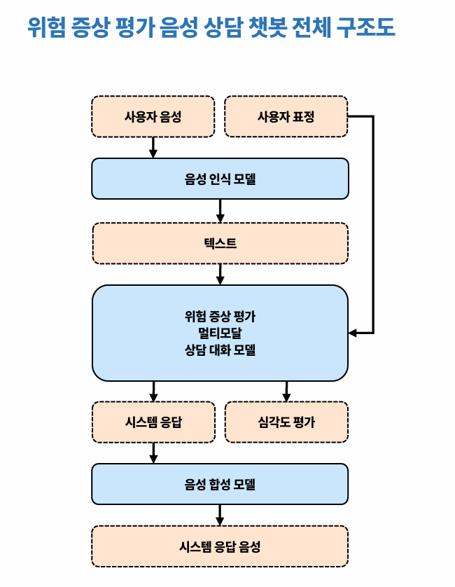

# 우울증 위험 평가 챗봇 기술 보고서

# 1. 시스템 개요

## 1.1 시스템 목적

본 시스템은 CES-D(Center for Epidemiologic Studies Depression Scale) 기반의 우울 위험 증상 평가를 자동화하기 위한 대화형 평가 시스템이다.

상담을 진행하며 사용자의 응답을 바탕으로 CES-D 문항을 평가하며, 각 문항에 대한 점수를 산출한다. 평가 완료 후에는 총점 및 문항별 결과를 제공하고, 상담 로그를 저장한다. 

상담 종료 후에는 별도 UNIST 요약 API가 상담 로그와 CES-D 점수를 기반으로 개인화된 결과 요약 JSON을 생성한다.

## 1.2 시스템 구성 (주요 기능)

```markdown
- FastAPI 기반 상담 API 제공
- 사용자별 상담 상태, 대화 이력, CES-D 점수, persona 관리
- vLLM OpenAI-compatible API를 통한 상담 응답 생성
- LoRA 어댑터 기반 CES-D 증상 탐지 및 빈도 점수 예측
- DeepFace 기반 얼굴 감정 분석
- KoBART 기반 persona(사용자 발화 요약) 추출
- 상담 로그, CESD 점수, 최종 결과 요약 파일 저장
```

# 2. 시스템 구조

## 2.1 주요 프로세스

| 프로세스 | 포트 | 역할 | 실행 파일 |
| --- | --- | --- | --- |
| Counseling API | 8000 | 사용자 상담 요청을 처리하고 상담 모델 응답을 제공 | `main.py`, `main.sh` |
| UNIST Summary API | 8001 | 상담 종료 후 상담 내용 요약 및 결과 생성 | `unist.py`, `unist.sh` |
| vLLM Server | 9000 | 상담 모델 및 요약 모델 추론 서비스 제공 | `vllm.sh` |

## 2.2 전체 아키텍처



## 2.3 요청 흐름

1. 클라이언트가 `POST /chat/chat1`로 사용자 발화를 전송한다.
2. `main.py`가 사용자 상태를 복원하거나 새 상담 상태를 초기화한다.
3. `CounselingChat.pre_chat()`이 현재 모드에 따라 다음 동작을 결정한다.
4. 즉시 반환 가능한 CES-D 질문이면 모델 생성 없이 응답한다.
5. 상담 응답이 필요하면 batch queue에 요청을 넣고 vLLM 서버에 generation 요청을 보낸다.
6. 응답 후 대화 로그와 tracker state를 `logs/{user_id}/`에 저장한다.
7. 상담이 종료되면 background task로 UNIST Summary API의 `/generate_summary`를 호출한다.

```markdown
| `HF_TOKEN` | 배포 환경 | Hugging Face gated/private model 접근용 token. 코드에서 직접 읽지는 않지만 모델 다운로드/캐시 준비 시 사용한다. |
| `LLAMA_DEVICE` | `model.py`, `docker-compose.yml` | CES-D Llama base model 및 LoRA adapter 로딩 device. 기본값은 `cuda:1`, compose 예시는 `cuda:0` |
```

# 3 디렉토리 파일 구조

## 3. 디렉터리 및 파일 구조

| 경로 | 설명 |
| --- | --- |
| `main.py` | 메인 FastAPI 앱. 상담 API, 로그 조회 API, 상태 복원/저장 로직 포함 |
| `model.py` | 상담 모델 관련 코드. phase 전환, CES-D 탐지/채점, vLLM 호출, 후처리 담당 |
| `tracker.py` | 사용자별 상태 저장소. history, phase, CES-D 점수, persona, 종료 여부 관리 |
| `unist.py` | 상담 종료 후 요약 JSON 생성용 별도 FastAPI 앱 |
| `persona.py` | KoBART 기반 persona extractor 로딩 및 추론 |
| `missing_labels.py` | TF-IDF 기반 exploration 질문 label 분류 |
| `utils.py` | API request/response Pydantic schema |
| `data/counsel_prompt.yaml` | 상담 phase, CES-D, 후처리, 결과 생성 prompt |
| `data/exploration.jsonl` | exploration 질문 예시 label 데이터 |
| `data/tfidf_store.pkl` | TF-IDF vectorizer 및 label store |
| `models/` | LoRA adapter, merged vLLM model, persona checkpoint 등 모델 파일 |
| `logs/` | 런타임에 생성되는 사용자별 상담 로그 및 state 저장 위치 |
| `requirements.txt` | Python dependency 목록 |

# 4. 런타임 의존성

## 4.1 주요 Python 패키지

프로젝트는 `requirements.txt` 기준으로 다음 계열의 패키지에 의존한다.

- API: `fastapi`, `uvicorn`, `pydantic`, `python-dotenv`
- LLM/ML: `torch`, `transformers`, `peft`, `vllm`, `accelerate`, `deepspeed`
- 데이터 처리: ``numpy``, ``pandas``, ``scipy``, ``scikit-learn`` 계열 런타임 객체
- 이미지/감정 분석: `Pillow`, `opencv-python-headless`, `deepface`, `retina-face`, `mtcnn`
- 외부 LLM API: `openai`, `anthropic`, `httpx`

## 4.2 GPU 의존성

현재 코드는 GPU 사용을 전제로 한다.

- `model.py`에서 `CUDA_VISIBLE_DEVICES`를 `0,1`로 설정한다.
- Llama 기반 CES-D 모델과 persona 모델은 `cuda:1`에 로드된다.
- vLLM 서버는 `vllm.sh`에서 별도 프로세스로 실행된다.
- CPU-only 환경에서는 모델 로딩 또는 추론이 실패할 가능성이 높다.

# 5. 환경 변수

- `.env` 파일은 저장소 루트에 위치한다. 문서화 대상 변수는 다음과 같다.

| 변수 | 사용 위치 | 설명 |
| --- | --- | --- |
| `API_TOKEN` | `main.py` | `/send_recent_logs` 보호용 Bearer token |
| `POSTECH_GPT_API` | `model.py` | 상담 응답 후처리에 사용하는 OpenAI-compatible API key |
| `UNIST_GPT_API` | `unist.py` | 요약 생성 API key |
| `VLLM_API_BASE` | `model.py` | vLLM OpenAI-compatible endpoint. 기본값은 `http://{gpu주소}:9000/v1` |
| `SSL_CERT_PATH` | `main.sh` | HTTPS 실행 시 인증서 경로 |
| `SSL_KEY_PATH` | `main.sh` | HTTPS 실행 시 private key 경로 |
| `HF_TOKEN` |  배포 환경 | Hugging Face gated/private model 접근용 token. 코드에서 직접 읽지는 않지만 모델 다운로드/캐시 준비 시 사용한다. |
| `LLAMA_DEVICE` | `model.py`, `docker-compose.yml`  | CES-D Llama base model 및 LoRA adapter 로딩 device. 기본값은 `cuda:1` |

# 6. 실행 방법

## 6.1 vLLM 서버

```bash
./vllm.sh
```

기본 설정:

- 모델 경로: `Counseling_KOR_2025/models/exaone_110_maxturn10/merged`
- host: `0.0.0.0`
- port: `9000`
- served model name: `counseling`

## 6.2 메인 서버 (상담 모델)

```bash
./main.sh
```

`main.sh`는 `.env`를 source한 뒤 다음 앱을 실행한다.

```bash
python -m uvicorn Counseling_KOR_2025.main:app --host 0.0.0.0 --port 8000
```

현재 스크립트는 `SSL_CERT_PATH`, `SSL_KEY_PATH`를 사용해 HTTPS 옵션을 전달한다. 인증서 경로가 없으면 실행에 실패할 수 있다.

## 6.3 **요약 및 사용자 보고용 결과 생성 API (UNIST)**

```bash
./unist.sh
```

다음 앱을 `8001` 포트로 실행한다.

```bash
python -m uvicorn Counseling_KOR_2025.unist:app --host 0.0.0.0 --port 8001
```

# 7. API 명세

## 7.1 상담 요청 `POST /chat/chat1`

Request body:

```json
{
  "sender_id": "user-001",
  "text": "요즘 잠을 잘 못 자요.",
  "image": "data:image/png;base64,..."
}
```

Response body:

```json
{
  "text": ["상담 응답 문장"],
  "score": "1: 0, 2: 1",
  "is_ending": false
}
```

필드 설명:

| 필드 | 타입 | 설명 |
| --- | --- | --- |
| `sender_id` | string | 사용자 식별자. 로그 디렉터리 이름으로도 사용됨 |
| `text` | string | 사용자 발화 |
| `image` | string | base64 data URL 형식 이미지. 없거나 분석 실패 시 `neutral` 처리 |
| `text` | string[] | 챗봇 응답 목록 |
| `score` | string | 현재까지 수집된 CES-D 점수 문자열 |
| `is_ending` | boolean | 상담 종료 여부 |

## 7.2 최근 상담 로그 조회 `GET /send_recent_logs?user_id={user_id}`

인증:

```
Authorization: Bearer {API_TOKEN}
```

동작:

- `logs/{user_id}/`에서 `{timestamp}_{user_id}.json` 패턴의 최신 로그를 반환한다.
- 디렉터리나 유효 로그가 없으면 404를 반환한다.

## 7.4 요약 생성 `POST /generate_summary?user_id={user_id}`

- 상담 완료 시 (`is_ending = True`), `model.py`에서 자동으로 호출함.

제공 앱:

- `unist.py`
- 기본 포트 `8001`

동작:

1. `logs/{user_id}/`에서 최신 상담 로그를 찾는다.
2. `history`와 `score`를 prompt에 삽입한다.
3. `gpt-4o-mini`를 호출해 구조화된 JSON 요약을 생성한다.
4. `logs/{user_id}/{timestamp}_{user_id}_summary.json`에 저장한다.

Response 예시:

```json
{
  "status": "done",
  "summary_file": "logs/user-001/2026-06-11_15-00-00_user-001_summary.json"
}
```

## 7.5 요약 상태 조회 `GET /summary_status?user_id={user_id}`

제공 앱:

- `unist.py`
- 기본 포트 `8001`

용도:

- 특정 사용자의 상담 요약 파일 생성 여부를 polling하기 위한 엔드포인트이다.
- `logs/{user_id}/`에서 `_{user_id}_summary.json` 패턴의 파일을 찾고, 파일명 정렬 기준 가장 마지막 파일을 최신 summary로 간주한다.

Query parameter:

| 이름 | 타입 | 필수 | 설명 |
| --- | --- | --- | --- |
| `user_id` | string | yes | 상태를 조회할 사용자 ID |

가능한 response body:

| 상황 | HTTP status | Response body | 설명 |
| --- | --- | --- | --- |
| 사용자 로그 디렉터리가 없음 | 200 | `{"status": "not_started"}` | `logs/{user_id}` 경로가 아직 생성되지 않은 상태 |
| 요약 파일이 없음 | 200 | `{"status": "not_started"}` | 사용자 로그 디렉터리는 있지만 `*_{user_id}_summary.json` 파일이 없는 상태 |
| 최신 요약 파일을 읽을 수 없음 | 200 | `{"status": "error"}` | JSON 파일 열기 또는 parsing 중 예외가 발생한 상태 |
| 최신 요약 파일에 `status` 필드가 있음 | 200 | `{"status": "{파일의 status}", "summary_file": "{파일명}"}` | 일반적으로 `/generate_summary`가 만든 파일이면 `done` 반환 |
| 최신 요약 파일에 `status` 필드가 없음 | 200 | `{"status": "unknown", "summary_file": "{파일명}"}` | summary 파일은 있으나 상태 필드가 없는 비정상 또는 수동 생성 파일 |

정상 완료 예시:

```json
{
  "status": "done",
  "summary_file": "2026-06-11_15-00-00_user-001_summary.json"
}
```

아직 요약이 시작되지 않은 경우:

```json
{
  "status": "not_started"
}
```

요약 파일은 있으나 읽기 실패한 경우:

```json
{
  "status": "error"
}
```

요약 파일은 있으나 내부 `status` 값이 없는 경우:

```json
{
  "status": "unknown",
  "summary_file": "2026-06-11_15-00-00_user-001_summary.json"
}
```

참고:

- `/generate_summary`가 정상적으로 완료되면 summary 파일 내부 `status`는 `"done"`으로 저장된다.
- `/generate_summary` 호출 자체가 실패하면 별도 summary 파일이 생성되지 않으므로, 이후 `/summary_status`는 보통 `"not_started"`를 반환한다.
- 이 엔드포인트는 요약 본문을 반환하지 않는다. 요약 내용은 `/get_summary`에서 조회한다.

## 7.6 요약 결과 조회 `GET /get_summary?user_id={user_id}`

호출 예시:

```bash
curl -X GET "<http://127.0.0.1:8001/get_summary?user_id=yang0617_3>"
```

Response 예시:

```json
{
  "status": "done",
  "summary": {
    "keywords": [
      {
        "type": "증상",
        "content": "슬픔으로 가득 찬 날들"
      },
      {
        "type": "솔루션",
        "content": "새로운 시작을 위한 첫걸음"
      }
    ],
    "key1": "상사에게 혼났다는 사건에서 경찰관님은 큰 슬픔을 느끼셨던 것 같습니다. 그로 인해 자신의 가치에 대한 의구심까지 드셨다고 이야기하셨죠. 현재는 힘든 감정들이 가득해 보이지만, 이러한 감정들은 인간이면 누구나 겪을 수 있는 것들이거든요. 특히 다른 사람에게 피해를 준다는 우려는 많은 사람들이 겪는 감정인데, 이를 통해 경찰관님의 공감능력이 얼마나 큰지를 보여주고 있어요.",
    "key2": "혹시 말씀하신 '다른 분들을 피해를 보게 할까 걱정된다'는 마음을 잠시 내려놓고, 단순히 매일 10분 정도 자신에게 집중하는 시간을 가져보는 건 어떨까요? 이렇게 스스로를 돌아보는 시간을 가지면 스트레스가 완화되고, 심박수를 안정시켜 교감신경의 흥분을 가라앉힐 수 있어요. 이후에 더욱 맑은 마음으로 업무에 임할 수 있게 될 것입니다.",
    "key3": "최근 계속 늘어나는 상사의 압박 속에서 느끼는 **심리적 피로**를 풀어줄 콘텐츠가 아래에 준비되어 있습니다. 이러한 자료들을 통해 지금의 힘든 기분을 조금이나마 덜 수 있길 바라요, 경찰관님."
  },
  "created_at": "2026-06-17T14:02:12.727037",
  "updated_at": "2026-06-17T14:02:12.727037",
  "source_file": "logs/yang0617_3/2026-06-17_14-00-00_yang0617_3.json"
}
```

# 8. 상담 상태

## 8.1 상담 phase

`ChatTracker.phase`는 사용자별 상담 단계를 저장한다.

| phase | 목적 | 전환 조건 |
| --- | --- | --- |
| `exploration` | 문제 상황, 감정, 맥락 탐색 | 최소/최대 턴 조건 및 `exploration_check` 결과 |
| `resolution` | 해결 방향과 실행 계획 탐색 | 최소/최대 턴 조건 및 `resolution_check` 결과 |
| `closing` | 상담 요약, 지지, 마무리 | 최소/최대 턴 조건 및 `closing_check` 결과 |
| `cesd_start` | CES-D 문진 시작 안내 | `chat_mode`를 CES-D 흐름으로 전환 |

현재 `model.py`의 기본 전환 설정:

| 현재 phase | 다음 phase | min_turns | max_turns |
| --- | --- | --- | --- |
| `exploration` | `resolution` | 5 | 5 |
| `resolution` | `closing` | 3 | 5 |
| `closing` | `cesd_start` | 1 | 1 |

## 8.2 chat mode

`ChatTracker.chat_mode`는 실제 응답 처리 모드를 제어한다.

| mode | 설명 |
| --- | --- |
| `counseling` | 일반 상담 응답 생성 |
| `dial_cesd` | 대화 중 CES-D 관련 증상 탐지 후 해당 문항 질문 상태 |
| `cesd_start` | 상담 종료 후 CES-D 문진 시작 준비 |
| `cesd` | CES-D 20문항 순차 문진 및 채점 |
| `result` | CES-D 결과 생성 및 상담 종료 처리 |

# 9. CES-D 처리 로직

### 9.1 대화 중 증상 탐지

`detect_symptom()`은 사용자의 발화를 Llama 기반 LoRA adapter `symptom`으로 처리해 CES-D 문항 번호를 예측한다.

- 모델 경로: `models/CESD_detector_ver2`
- adapter name: `symptom`
- 예측값: `1`부터 `20` 사이의 문항 번호 또는 `0`

새로운 CES-D 문항이 탐지되고 아직 점수화되지 않았다면, 시스템은 해당 문항 질문을 반환하고 다음 사용자 응답을 `dial_cesd` 모드에서 채점한다.

## 9.2 CES-D 점수 예측

`score_depression()`은 Llama 기반 LoRA adapter `freq`로 사용자 응답을 `-1`, `0`, `1`, `2`, `3` 중 하나로 분류한다.

- 모델 경로: `models/cesd_freq1103`
- adapter name: `freq`
- `-1`: 채점 불가
- `0~3`: 빈도 점수

문항 `4`, `8`, `12`, `16`은 `tracker.insert_cesd_info()`에서 역채점한다.

## 9.3 결과 등급

20문항이 모두 완료되면 총점을 계산하고 결과 등급을 저장한다.

| 총점 | 결과 |
| --- | --- |
| 0-15 | `normal` |
| 16-20 | `mild` |
| 21-24 | `moderate` |
| 25 이상 | `severe` |

채점 불가 값이 남아 있으면 결과는 `진단 불가`로 저장된다.

# 10. 로그 및 상태 저장

## 10.1 저장 위치

사용자별 로그는 다음 위치에 저장된다.

```
logs/{user_id}/
```

## 10.2 상담 로그 파일

파일명:

```
{YYYY-MM-DD_HH-MM-SS}_{user_id}.json
```

주요 필드:

```json
{
  "history": [
    {
      "speaker": "User",
      "text": "사용자 발화",
      "time": "2026-06-11T15:00:00"
    },
    {
      "speaker": "Bot",
      "text": "챗봇 응답",
      "time": "2026-06-11T15:00:00"
    }
  ],
  "score": {
    "1": 0,
    "2": 1,
    ...
    "20": 2
  },
  "total_score": 12,
  "result": "normal"
}
```

phase 전환 시 `history`에 다음 형태의 항목이 추가된다.

```json
{
  "speaker": "Stage change",
  "text": "phase: exploration to resolution"
}
```

## 10.3 상태 스냅샷 파일 (serverside 확인용)

파일명:

```
state_{user_id}_{YYYY-MM-DD_HH-MM-SS}.json
```

저장 필드:

- `cesd_info`
- `chat_mode`
- `cesd_count`
- `cesd_num`
- `terminate`
- `phase`
- `phase_turn`
- `score`
- `history_phase`
- `persona`
- `history`
- `time`
- `turn`
- `persona_user_utts`

## 10.4 상태 복원 정책

`ensure_tracker_time_on_connect()`는 사용자 재접속 시 다음 기준으로 상태를 복원한다.

- `logs/{user_id}/`가 없거나 state 파일이 없으면 새 상담 시작
- 최신 state의 `time`이 현재 시각 기준 24시간 이내이면 기존 state 복원
- 24시간이 지났거나 state 시간이 유효하지 않으면 새 상담 상태로 reset

# 11. 모델 및 외부 서비스

## 11.0 모델 구성 요약

| 구분 | 모델/서비스 | 위치 또는 호출 방식 | 역할 |
| --- | --- | --- | --- |
| 상담 생성 모델 | EXAONE merged model | `models/exaone_110_maxturn10/merged`, vLLM served name `counseling` | 상담 phase별 응답, phase 전환 판정, 결과 응답 생성 |
| CES-D 증상 탐지 | `meta-llama/Llama-3.1-8B-Instruct` + LoRA `symptom` | `models/CESD_detector_ver2` | 사용자 발화가 어떤 CES-D 문항과 관련되는지 예측 |
| CES-D 빈도 채점 | `meta-llama/Llama-3.1-8B-Instruct` + LoRA `freq` | `models/cesd_freq1103` | CES-D 질문에 대한 사용자 응답을 `-1~3` 점수로 분류 |
| 후처리 GPT | `gpt-4o-mini` | OpenAI async client, `POSTECH_GPT_API` | 상담 응답의 안전성, 말투, closing 적절성 보정 |
| 요약 GPT | `gpt-4o-mini` | OpenAI client, `UNIST_GPT_API` | 상담 로그와 CES-D 점수 기반 결과 요약 JSON 생성 |
| 내담자 발화 요약 | `gogamza/kobart-base-v2` + checkpoint | `models/persona_no_history.ckpt` | 사용자 발화 기반 요약 갱신 |
| 얼굴 감정 분석 | DeepFace emotion analyzer | request image base64 입력 | 이미지가 포함된 요청의 dominant emotion 추출 |

## 11.1 vLLM 상담 모델

`CounselingChat.generate()`는 OpenAI-compatible chat completions API로 vLLM 서버를 호출한다.

Endpoint:

```
{VLLM_API_BASE}/chat/completions
```

요청 payload 주요값:

```json
{
  "model": "counseling",
  "messages": [],
  "temperature": 0.7,
  "max_tokens": 256
}
```

## 11.2 후처리 GPT 호출

`post_process_llm()`은 OpenAI async client로 `gpt-4o-mini`를 호출해 응답 안전성, 말투, closing 적절성을 보정한다.

## 11.3 Persona extractor

`PersonaExtractor`는 `gogamza/kobart-base-v2`를 기반으로 하고, checkpoint `models/persona_no_history.ckpt`를 로드한다. 사용자 발화 3개 단위로 persona를 갱신한다.

persona는 환자 발화의 요약으로 정의한다. 

## 11.4 얼굴 감정 분석

`get_emotion()`은 request의 base64 image를 `pic/output.png`로 임시 저장하고 DeepFace emotion 분석을 수행한다. 실패 시 `neutral`을 반환하며, 임시 파일은 삭제한다.

# 12. 운영 체크리스트

- 24GB GPU 2장 또는 코드의 device 설정과 맞는 CUDA 환경을 준비한다.
    - 현재 GPU 환경: RTX 4090 24GB * 2
    - CUDA Version: 12.6
- vLLM 서버가 먼저 실행되어 있고 `VLLM_API_BASE`가 올바른지 확인한다.
- `POSTECH_GPT_API`, `UNIST_GPT_API`, `API_TOKEN`을 `.env`에 설정한다.
- `models/` 하위 checkpoint와 adapter 파일이 배포 환경에 존재하는지 확인한다.
- `logs/` 저장 경로의 쓰기 권한과 디스크 용량을 확인한다.
- HTTPS 실행 시 `SSL_CERT_PATH`, `SSL_KEY_PATH`를 설정한다.
- 상담 API, UNIST API, vLLM 서버의 포트 충돌 여부를 확인한다.